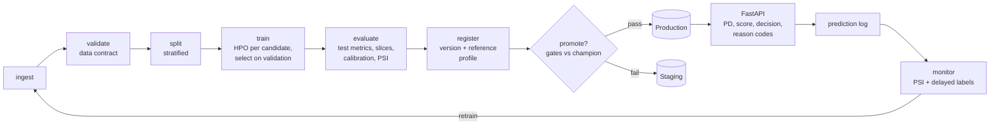

# Credit Risk MLOps

[](https://github.com/YOUR_GITHUB_USERNAME/credit-risk-mlops/actions/workflows/ci.yml)


The full training lifecycle of a credit default model, built as code rather than notebooks: a data contract, reproducible feature pipelines, a points-based scorecard alongside gradient boosting, hyperparameter search, experiment tracking, a model registry, champion/challenger promotion gates (including fairness and stability checks), a prediction API with adverse-action reason codes, and drift monitoring that decides when to retrain.

Uses the public [Give Me Some Credit](https://www.kaggle.com/c/GiveMeSomeCredit) dataset (150k borrowers, 2-year serious delinquency) or a built-in generator that reproduces its quirks (missing income, sentinel codes, debt ratios that turn into dollar amounts).

## The lifecycle



Each stage is a function with declared inputs, outputs and config parameters. The runner fingerprints them (config + file hashes + upstream fingerprints) and skips stages whose fingerprint has not changed, so re-running after a config edit only redoes what that edit affects.

```text
$ credit-risk run
ingest    ran       0.4s  {"rows": 30000, "default_rate": 0.0638}
validate  ran       0.1s  {"passed": true, "warnings": ["debt_ratio: range [0, 5]"]}
split     ran       0.4s  {"train": 18000, "valid": 6000, "test": 6000}
train     ran      21.5s  {"selected_model": "scorecard", ...}
evaluate  ran       1.2s  {...}
register  ran       0.2s  {"version": 1}
promote   ran       0.0s  {"version": 1, "promote": true}

$ credit-risk run          # nothing changed
ingest    cached ... register  cached
promote   ran       0.0s  {"version": 1, "promote": false, "note": "already in Production"}
```
(Output from a run on synthetic data; timings vary.)

## Quickstart

```bash
git clone https://github.com/YOUR_GITHUB_USERNAME/credit-risk-mlops.git
cd credit-risk-mlops
python -m venv .venv && source .venv/bin/activate
