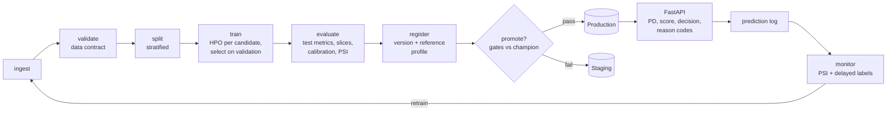

# Credit Risk MLOps

[](https://github.com/YOUR_GITHUB_USERNAME/credit-risk-mlops/actions/workflows/ci.yml)


The full training lifecycle of a credit default model, built as code rather than notebooks: a data contract, reproducible feature pipelines, a points-based scorecard alongside gradient boosting, hyperparameter search, experiment tracking, a model registry, champion/challenger promotion gates (including fairness and stability checks), a prediction API with adverse-action reason codes, and drift monitoring that decides when to retrain.

Uses the public [Give Me Some Credit](https://www.kaggle.com/c/GiveMeSomeCredit) dataset (150k borrowers, 2-year serious delinquency) or a built-in generator that reproduces its quirks (missing income, sentinel codes, debt ratios that turn into dollar amounts).

## The lifecycle



Each stage is a function with declared inputs, outputs and config parameters. The runner fingerprints them (config + file hashes + upstream fingerprints) and skips stages whose fingerprint has not changed, so re-running after a config edit only redoes what that edit affects.

```text
$ credit-risk run
ingest    ran       0.4s  {"rows": 30000, "default_rate": 0.0638}
validate  ran       0.1s  {"passed": true, "warnings": ["debt_ratio: range [0, 5]"]}
split     ran       0.4s  {"train": 18000, "valid": 6000, "test": 6000}
train     ran      21.5s  {"selected_model": "scorecard", ...}
evaluate  ran       1.2s  {...}
register  ran       0.2s  {"version": 1}
promote   ran       0.0s  {"version": 1, "promote": true}

$ credit-risk run          # nothing changed
ingest    cached ... register  cached
promote   ran       0.0s  {"version": 1, "promote": false, "note": "already in Production"}
```
(Output from a run on synthetic data; timings vary.)

## Quickstart

```bash
git clone https://github.com/YOUR_GITHUB_USERNAME/credit-risk-mlops.git
cd credit-risk-mlops
python -m venv .venv && source .venv/bin/activate
pip install -e ".[dev]"

make pipeline          # ingest -> ... -> promote, on synthetic data
make serve             # API for the Production model on :8000 (docs at /docs)
make monitor-demo      # score a drifted batch and get a retrain recommendation
make test
```

On the real data: download `cs-training.csv` into `data/raw/` (see [data/README.md](data/README.md)), set `data.source: file` in `configs/pipeline.yaml`, and run `credit-risk run`.

## What each stage does

| Stage | What happens | Output |
|---|---|---|
| **ingest** | Read Kaggle CSV or generate data, map to snake_case schema | `data/interim/dataset.csv` |
| **validate** | Data contract: required columns, types, null-rate limits, ranges, target rate, duplicate ids. Blocking failures stop the run | `reports/validation.json` |
| **split** | Stratified train / validation / test | `data/processed/*.csv` |
| **train** | For each candidate (WoE scorecard, logistic, HistGradientBoosting, optional LightGBM): Optuna search with cross-validated AUC, defaults always tried first; refit; score validation. Best family is refit on train + validation | `artifacts/model.joblib`, `reports/training.json`, tracked runs |
| **evaluate** | Test-set AUC, Gini, KS, Brier, ECE, risk deciles, train-vs-test score PSI, age-band slices, ROC / calibration / score plots, scorecard points table | `reports/evaluation.md` |
| **register** | New registry version with metrics, params, input signature and a reference profile for drift monitoring | `model_registry/<name>/vN/` |
| **promote** | Re-score the current champion on the same test set, then apply gates (below). Pass → Production (old champion archived); fail → Staging | `reports/promotion.json` |

### Promotion gates

| Gate | Default |
|---|---|
| Minimum test AUC | 0.75 |
| Improvement over champion (same test set) | +0.002 AUC |
| Expected calibration error | ≤ 0.03 |
| Train-vs-test score PSI | ≤ 0.10 |
| AUC gap across age bands | ≤ 0.10 |
| Approval-rate ratio across age bands | ≥ 0.80 (four-fifths rule) |

All thresholds live in `configs/pipeline.yaml`. Rationale and the fairness caveats are in [docs/model_governance.md](docs/model_governance.md).

## Models

- **WoE scorecard**: monotonic weight-of-evidence binning with information value, logistic regression on WoE, and industry-standard score scaling (PDO, base score, base odds). Every applicant's score is the sum of attribute points, and a test checks that the points add up to exactly the score implied by the predicted PD.
- **Logistic regression** on engineered features with imputation indicators.
- **Histogram gradient boosting** (scikit-learn) and **LightGBM** (optional).

All of them share one preprocessing pipeline: sentinel codes 96/98 → missing plus a flag, domain features (total past-due events, monthly debt, income per household member, a "clean" debt ratio that ignores dollar amounts recorded when income is missing), and winsorising at quantiles learned on training data.

## Serving

```bash
curl -s localhost:8000/v1/predict -H 'content-type: application/json' -d '{
  "applicant_id": 1001, "revolving_utilization": 0.95, "age": 29, "late_30_59": 3,
  "debt_ratio": 0.9, "monthly_income": 2500, "open_credit_lines": 4, "late_90": 2,
  "real_estate_loans": 0, "late_60_89": 1, "dependents": 2
}'
```
